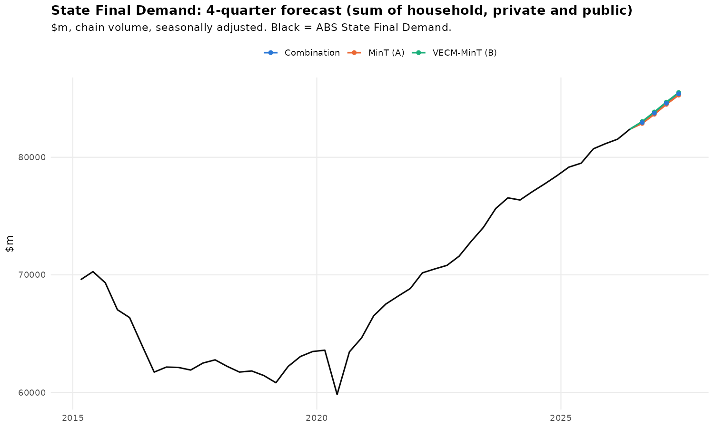

# Western Australia State Final Demand: 4-quarter forecast

[](https://github.com/DavidLindarte/wa-state-final-demand-forecast/actions/workflows/quarterly-forecast.yml)

**Live dashboard:** https://davidlindarte.github.io/wa-state-final-demand-forecast/

This project forecasts Western Australia's **State Final Demand (SFD)**, which is household consumption plus private investment plus public spending, four quarters ahead. It was built in response to a government agency brief. The models are econometric only (no machine learning) and written in R. After every ABS National Accounts release, a scheduled pipeline downloads the new data, re-estimates every model and republishes the forecast.



## Results (ABS data to June quarter 2026)

| Quarter | Combination A+B | MinT (A) | VECM-MinT (B) | Average-growth benchmark |
|---|---|---|---|---|
| 2026 Q3 | **0.69%** | 0.59% | 0.78% | 0.94% |
| 2026 Q4 | **0.96%** | 0.94% | 0.98% | 0.94% |
| 2027 Q1 | **1.00%** | 1.00% | 0.99% | 0.94% |
| 2027 Q2 | **0.94%** | 0.92% | 0.96% | 0.94% |

Quarter-on-quarter growth, 100 × Δlog. SFD is projected to reach about **$85.4bn (chain volume) by June 2027, +3.6% year on year**.

**Hold-out test (last 4 quarters):** the VECM-MinT model had the lowest level error (RMSE of log level 0.33 vs 0.35 for the benchmark). With only four quarters this is a sanity check, not a formal test. The group's 78-origin expanding-window backtest is the formal evaluation.

## Method

1. **Data:** ABS 5206.0 Table 30, *State Final Demand, Detailed Components: Western Australia*, seasonally adjusted chain volume measures, quarterly from 1985 Q3. The 1998 Q1 privatisation outlier in public investment is smoothed, and COVID quarters get dummies.
2. **Stationarity:** ADF and KPSS tests on every series, in levels and differences.
3. **Model A:** an ARIMA on each sector total and on every component, reconciled with **MinT** (minimum-trace, shrinkage covariance) so that the components add up to the total.
4. **Model B:** a **VECM** on each sector's cointegrated block (Johansen and Engle–Granger at 5%), with ARIMA for the other components, then MinT:
   - *Household:* essentials vs discretionary consumption
   - *Private:* ownership transfer costs vs household consumption (the housing/wealth effect, conditional on the household forecast)
   - *Public:* state and local government consumption vs investment (the state budget relationship)
5. **Headline:** the average of A and B. SFD is the sum of the three sector forecasts.

## Automated pipeline

```
GitHub Actions (12 Mar / Jun / Sep / Dec)
  ├─ R/build_inputs.R                 readabs → ABS 5206.0 Table 30 → data/household|private|goverment.xlsx
  ├─ R/forecast_sfd_all_sectors_dlog.R stationarity → ARIMA/VECM → MinT → forecasts, hold-out, charts
  └─ pipeline/export_results.py       → docs/data/latest.json, docs/figures, data/forecast_history.csv
                                        GitHub Pages dashboard (docs/index.html)
```

`data/forecast_history.csv` keeps every forecast vintage, so each forecast can be scored against the actual figures once the ABS publishes them.

## Run it locally

```r
install.packages(c("readabs","readxl","writexl","jsonlite","dplyr","tidyr","ggplot2","forecast","urca","vars","tseries"))
```
```bash
Rscript R/build_inputs.R                       # or: Rscript R/build_inputs.R path/to/5206030_SFD_WA.xlsx
cd output && SFD_DATA_DIR=../data Rscript ../R/forecast_sfd_all_sectors_dlog.R && cd ..
python pipeline/export_results.py
```

## Repository layout

```
R/build_inputs.R                    ABS download + reshape into the three model inputs
R/forecast_sfd_all_sectors_dlog.R   the forecasting model (sector hierarchy, ARIMA/VECM/MinT)
pipeline/export_results.py          results → dashboard JSON + forecast history
data/                               model inputs (ABS, CC BY 4.0) and forecast history
output/                             workbooks and charts from the latest run
docs/                               GitHub Pages dashboard
```

## Credits

This was a group project for the MSc in Predictive Analytics at Curtin University (2026). This repository contains **my part of the work**: the sector-hierarchy model (household, private and public sectors, with ARIMA/VECM reconciled by MinT). The team's Python backtesting notebook is not included.

Data © Commonwealth of Australia (Australian Bureau of Statistics), CC BY 4.0.

---
**David Lindarte Burgos** · [Portfolio](https://davidlindarte.github.io) · Petroleum engineer and MSc Predictive Analytics (Finance & Investment) student, Curtin University
